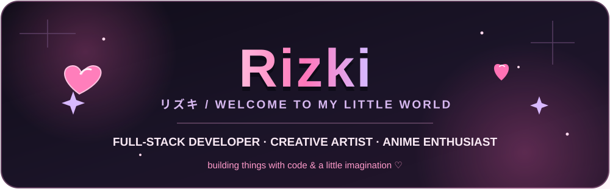
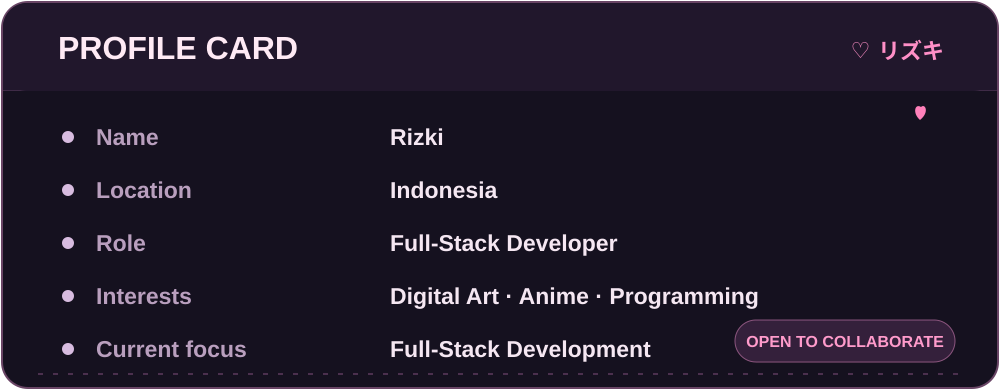
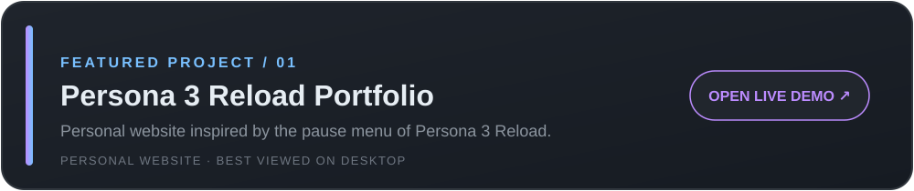
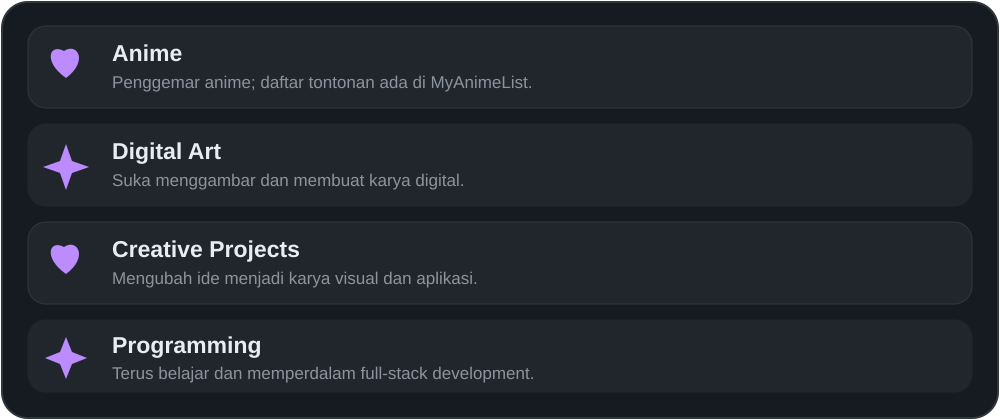
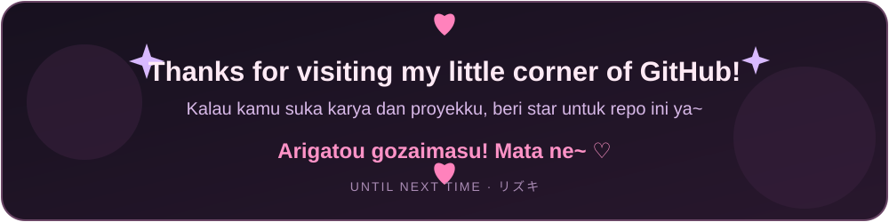

<!--
  SHAKANAAA · DARK KAWAII PROFILE
  Keep the assets folder beside this README.md.
  GitHub does not allow custom CSS/backgrounds in README; dark panels are rendered as SVG assets.
-->

  

  

  
  &nbsp; 
  &nbsp; 

  

  ✦ &nbsp; CODE WITH CURIOSITY &nbsp; · &nbsp; CREATE WITH FEELING &nbsp; · &nbsp; LIVE WITH IMAGINATION &nbsp; ✦

---

Halo, aku **Rizki** — developer sekaligus artist dari Indonesia. Aku suka mengeksplorasi programming, menggambar, digital art, dan anime. Saat ini aku sedang memperdalam **full-stack development** sambil terus membuat hal-hal kreatif.

- 🌸 **Focus:** Full-Stack Development
- 🎨 **Creative side:** Drawing & Digital Art
- 🍥 **Off-screen world:** Anime
- 💌 **Collaboration:** Open to interesting projects

hor hor hor~ thanks for stopping by ♡

<!-- Yui separator -->

  ✦ ─────────────────── ♡ ─────────────────── ✦ 
   
  ♡ ─────────────────── ✦ ─────────────────── ♡

  

More little creations will be added here as they grow~

  ✦ ─────────────────── ♡ ─────────────────── ✦ 
   
  ♡ ─────────────────── ✦ ─────────────────── ♡

<table align="center" width="100%">
  <tr>
    <td align="center" valign="top" width="50%">
      <b>🌷 LANGUAGES</b>  
      
    </td>
    <td align="center" valign="top" width="50%">
      <b>🎀 FRONTEND</b>  
      
    </td>
  </tr>
  <tr>
    <td align="center" valign="top">
       <b>🍓 BACKEND</b>  
      
    </td>
    <td align="center" valign="top">
       <b>🍰 DATABASE &amp; ORM</b>  
      
    </td>
  </tr>
  <tr>
    <td align="center" valign="top">
       <b>🖌️ DESIGN &amp; CREATIVE</b>  
      
    </td>
    <td align="center" valign="top">
       <b>✨ OTHERS</b>  
      
    </td>
  </tr>
</table>

  ✦ ─────────────────── ♡ ─────────────────── ✦ 
   
  ♡ ─────────────────── ✦ ─────────────────── ♡

  
  

  

  

  ✦ ─────────────────── ♡ ─────────────────── ✦ 
   
  ♡ ─────────────────── ✦ ─────────────────── ♡

  
  

  ✦ ─────────────────── ♡ ─────────────────── ✦ 
   
  ♡ ─────────────────── ✦ ─────────────────── ♡

  
  
  
  
  
  

🌙  MADE WITH CODE, CREATIVITY, AND A LITTLE BIT OF KAWAII MAGIC  ♡

