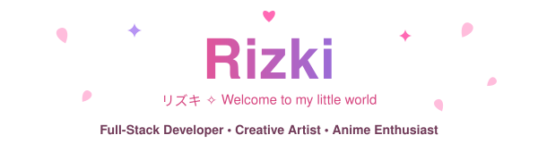
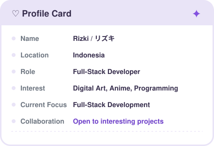
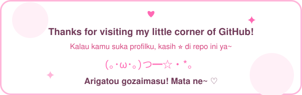

<!-- ================================================================
     SHAKANAAA · KAWAII DEVELOPER PROFILE
     Keep this README compatible with GitHub Markdown / HTML.
     Local visual assets live in ./assets/.
     ================================================================ -->

  <a href="https://shakanaaa.github.io/portofolio/">
    <picture>
      <source media="(prefers-color-scheme: dark)" srcset="./assets/hero-dark.svg">
      
    </picture>
  </a>

  

  
  &nbsp; ♡ welcome to my little corner of the internet ♡

  

  <b>full-stack developer</b> &nbsp;·&nbsp; <b>creative artist</b> &nbsp;·&nbsp; <b>anime enthusiast</b>

  
  

---

  <picture>
    <source media="(prefers-color-scheme: dark)" srcset="./assets/title-about-dark.svg">
    
  </picture>

  

Halo, aku **Rizki** — developer sekaligus artist dari Indonesia. Aku suka mengeksplorasi dunia programming, menggambar, digital art, dan anime. Saat ini aku sedang memperdalam full-stack development sambil terus membuat hal-hal kreatif.

- 🌸 **Focus:** Full-Stack Development
- 🎨 **Creative side:** Drawing & Digital Art
- 🍥 **Off-screen world:** Anime
- 💌 **Collaboration:** Open to interesting projects

 

hor hor hor~ thanks for stopping by! ♡

---

  <picture>
    <source media="(prefers-color-scheme: dark)" srcset="./assets/title-projects-dark.svg">
    
  </picture>

<table align="center" width="100%">
  <tr>
    <td align="center">
       
      <a href="https://shakanaaa.github.io/portofolio/"><b>Persona 3 Reload Portfolio</b></a>
        
      Portfolio pribadi dengan tampilan yang terinspirasi dari pause menu <i>Persona 3 Reload</i>.
        
      Personal website · Best viewed on desktop
       
      <a href="https://shakanaaa.github.io/portofolio/">♡ Open live demo ♡</a>
        
    </td>
  </tr>
</table>

  More little creations will be added here as they grow~

---

  <picture>
    <source media="(prefers-color-scheme: dark)" srcset="./assets/title-tech-dark.svg">
    
  </picture>

  <b>🌷 Languages</b> 
  

  <b>🎀 Frontend</b> 
  

  <b>🍓 Backend</b> 
  

  <b>🍰 Database &amp; ORM</b> 
  

  <b>🖌️ Design &amp; Creative</b> 
  

  <b>✨ Others</b> 
  

---

  <picture>
    <source media="(prefers-color-scheme: dark)" srcset="./assets/title-stats-dark.svg">
    
  </picture>

  <picture>
    <source media="(prefers-color-scheme: dark)" srcset="https://github-readme-stats.vercel.app/api?username=shakanaaa&show_icons=true&theme=transparent&hide_border=true&title_color=FF8FC7&text_color=F5D0E6&icon_color=C4B5FD&ring_color=FF8FC7">
    
  </picture>
  <picture>
    <source media="(prefers-color-scheme: dark)" srcset="https://github-readme-stats.vercel.app/api/top-langs/?username=shakanaaa&layout=compact&theme=transparent&hide_border=true&title_color=FF8FC7&text_color=F5D0E6">
    
  </picture>

  <picture>
    <source media="(prefers-color-scheme: dark)" srcset="https://streak-stats.demolab.com?user=shakanaaa&theme=transparent&hide_border=true&ring=FF8FC7&fire=FF8FC7&currStreakNum=F5D0E6&sideNums=F5D0E6&currStreakLabel=C4B5FD&sideLabels=C4B5FD&dates=A78BFA">
    
  </picture>

  <picture>
    <source media="(prefers-color-scheme: dark)" srcset="https://github-readme-activity-graph.vercel.app/graph?username=shakanaaa&hide_border=true&bg_color=0D1117&color=F5D0E6&line=FF85C0&point=FF69B4&area=true&area_color=6B2148&title_color=FF8FC7">
    
  </picture>

---

  <picture>
    <source media="(prefers-color-scheme: dark)" srcset="./assets/title-interests-dark.svg">
    
  </picture>

  

  
  

---

  <picture>
    <source media="(prefers-color-scheme: dark)" srcset="./assets/title-contact-dark.svg">
    
  </picture>

  
  
  
  
  
  

  

  <picture>
    <source media="(prefers-color-scheme: dark)" srcset="./assets/closing-dark.svg">
    
  </picture>

