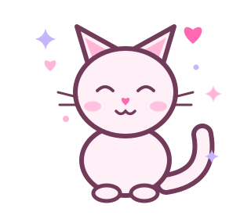

<div align="center">

<picture>
  <source media="(prefers-color-scheme: dark)" srcset="assets/hero-dark.svg">
  
</picture>


<a href="https://shakanaaa.github.io/portofolio/"></a>
<a href="https://discord.gg/vNMPTWY9s"></a>
<a href="https://instagram.com/this_whisky69"></a>
<a href="https://tiktok.com/@ryynx20"></a>
<a href="https://x.com/ThisRizky699"></a>
<a href="mailto:rizkyclip69@gmail.com"></a>
<a href="https://myanimelist.net/profile/Shakanaa"></a>

</div>

## 🌸 About Me <sub>· 私について</sub>


*Hor Hor Hor~* ♡

Halo, aku Rizki. Developer sekaligus artist dari Indonesia yang suka nonton anime, lagi sibuk mendalami full-stack development, dan senang bikin sesuatu yang kreatif.

**Lokasi** · Indonesia<br/>
**Minat** · Digital Art, Anime, Programming<br/>
**Fokus sekarang** · Full-Stack Development<br/>
**Portfolio** · [shakanaaa.github.io/portofolio](https://shakanaaa.github.io/portofolio/)

<br clear="right"/>

> [!IMPORTANT]
> **Open to collaboration.** Terbuka untuk kolaborasi proyek menarik, chat aja ya ♡

## 🎮 Featured Projects <sub>· 注目のプロジェクト</sub>

> **[Persona 3 Reload Portfolio](https://shakanaaa.github.io/portofolio/)**
>
> Portfolio pribadi dengan tampilan bergaya Pause Menu dari *Persona 3 Reload*.
>
>   <a href="https://shakanaaa.github.io/portofolio/"></a>

<!--
  Tambah project baru dengan menyalin blok kutipan di atas, lalu isi nama, deskripsi singkat,
  badge teknologi/status, serta link repository dan live demo.
  Atau pakai pin card dari repo asli:
  <a href="https://github.com/shakanaaa/NAMA-REPO"></a>
-->

## 🍓 Tech Stack <sub>· 技術スタック</sub>

| Kategori | Teknologi |
|:--|:--|
| **Languages** |  |
| **Frontend** |  |
| **Backend** |  |
| **Database & ORM** |  |
| **Design & Creative** |  |
| **Others** |  |

## ✧ GitHub Stats <sub>· 統計</sub>

<p align="center">
  <picture>
    <source media="(prefers-color-scheme: dark)" srcset="https://github-readme-stats.vercel.app/api?username=shakanaaa&show_icons=true&theme=transparent&hide_border=true&title_color=FF8FC7&text_color=F5D0E6&icon_color=C4B5FD&ring_color=FF8FC7">
    
  </picture>
  <picture>
    <source media="(prefers-color-scheme: dark)" srcset="https://github-readme-stats.vercel.app/api/top-langs/?username=shakanaaa&layout=compact&theme=transparent&hide_border=true&title_color=FF8FC7&text_color=F5D0E6">
    
  </picture>
</p>

<p align="center">
  <picture>
    <source media="(prefers-color-scheme: dark)" srcset="https://streak-stats.demolab.com?user=shakanaaa&theme=transparent&hide_border=true&ring=FF8FC7&fire=FF8FC7&currStreakNum=F5D0E6&sideNums=F5D0E6&currStreakLabel=C4B5FD&sideLabels=C4B5FD&dates=A78BFA">
    
  </picture>
</p>

<p align="center">
  <picture>
    <source media="(prefers-color-scheme: dark)" srcset="https://github-readme-activity-graph.vercel.app/graph?username=shakanaaa&hide_border=true&bg_color=0D1117&color=F5D0E6&line=FF8FC7&point=C4B5FD&area=true&area_color=FF8FC7&title_color=FF8FC7">
    
  </picture>
</p>

## 🎀 Interests <sub>· 好きなもの</sub>



**Anime** · penggemar anime, daftar tontonanku ada di [MyAnimeList](https://myanimelist.net/profile/Shakanaa)

**Digital Art** · suka menggambar, karyaku ada di [Instagram](https://instagram.com/this_whisky69)

**Creative Projects** · mengubah ide jadi karya, dari visual sampai [website](https://shakanaaa.github.io/portofolio/)

**Programming** · lagi mendalami full-stack development

<br clear="left"/>

## 💌 Contact <sub>· 連絡先</sub>


Terbuka buat kolaborasi proyek, chat aja ya ♡

- **Discord** · [Join server](https://discord.gg/vNMPTWY9s)
- **Instagram** · [@this_whisky69](https://instagram.com/this_whisky69)
- **TikTok** · [@ryynx20](https://tiktok.com/@ryynx20)
- **X** · [@ThisRizky699](https://x.com/ThisRizky699)
- **Email** · [rizkyclip69@gmail.com](mailto:rizkyclip69@gmail.com)
- **MyAnimeList** · [Shakanaa](https://myanimelist.net/profile/Shakanaa)

<br clear="right"/>

<div align="center">


```
 ∧＿∧
(｡･ω･｡)つ━☆・*。
```

**Thanks for visiting my little corner of GitHub!**<br/>
Kalau kamu suka profilku, kasih ⭐ di repo ini ya~

**Arigatou gozaimasu! Mata ne~ ♡**


</div>
