<!--
  SHAKANAAA · PROFILE
  Keep the assets folder beside this README.md.
  GitHub strips custom CSS from READMEs, so every panel is an SVG.
  Rebuild them with tools/build.py (see tools/README.md).
-->

  <a href="#about">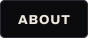</a>
  <a href="#work">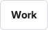</a>
  <a href="#stack">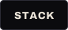</a>
  <a href="#stats">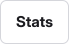</a>
  <a href="#interests">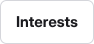</a>
  <a href="#contact">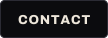</a>

    <a href="https://shakanaaa.github.io/portofolio/"><picture>
      <source media="(max-width: 600px)" srcset="./assets/m/hero.svg">
      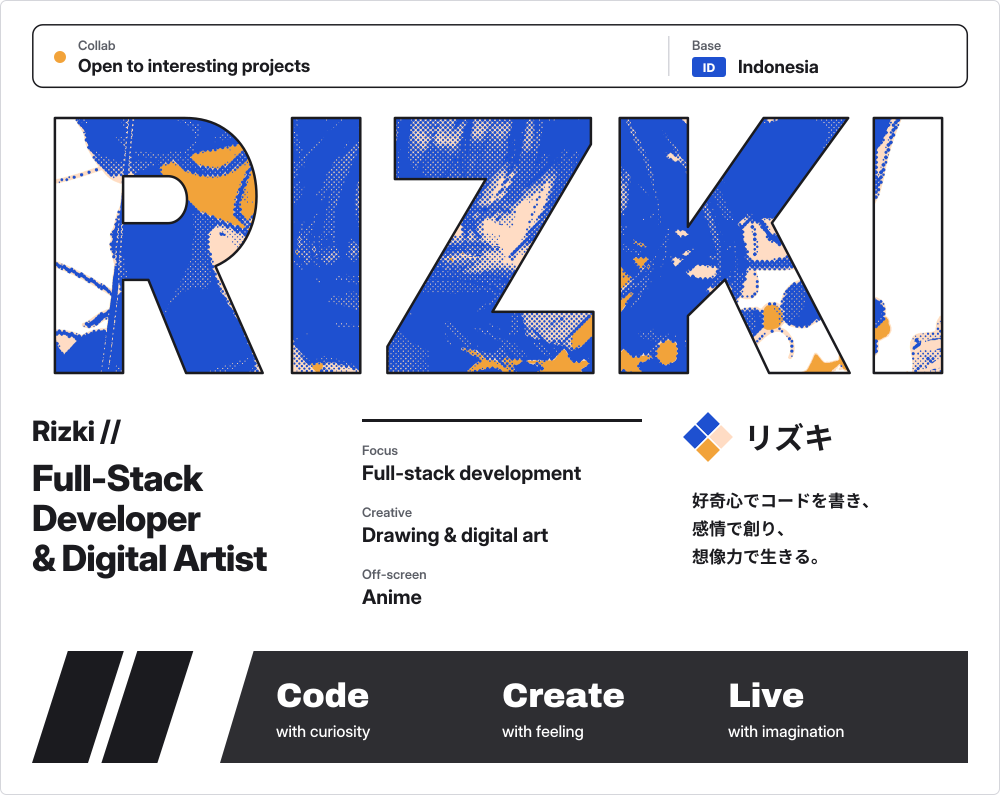
    </picture></a>

    <picture>
      <source media="(max-width: 600px)" srcset="./assets/m/strip.svg">
      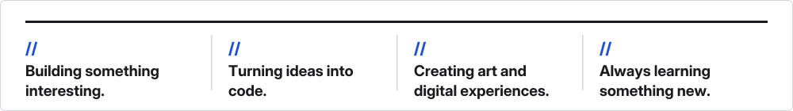
    </picture>

  
  &nbsp; 
  &nbsp; 

  

    <picture>
      <source media="(max-width: 600px)" srcset="./assets/m/about.svg">
      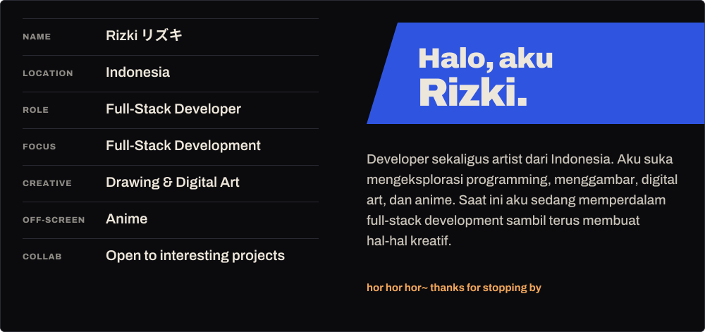
    </picture>

    <a href="https://shakanaaa.github.io/portofolio/"><picture>
      <source media="(max-width: 600px)" srcset="./assets/m/work.svg">
      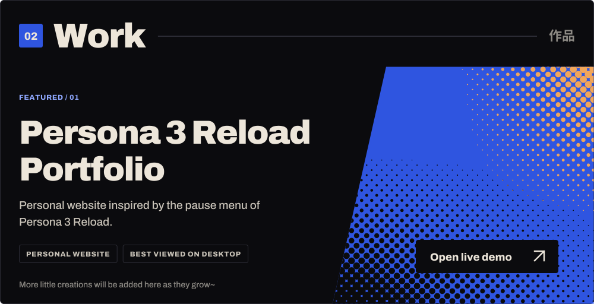
    </picture></a>

<a id="stack">

  

</a>

    <picture>
      <source media="(max-width: 600px)" srcset="./assets/m/stack.svg">
      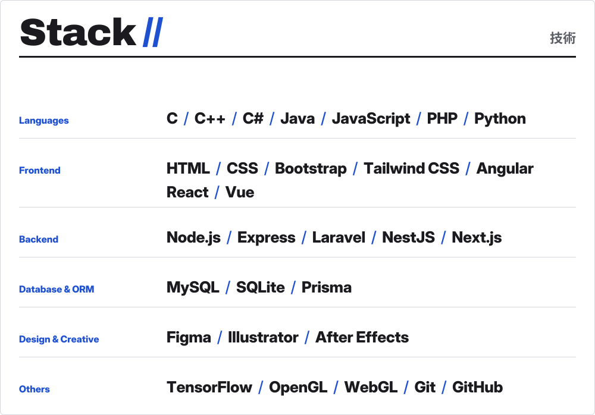
    </picture>

    <picture>
      <source media="(max-width: 600px)" srcset="./assets/m/sec-stats.svg">
      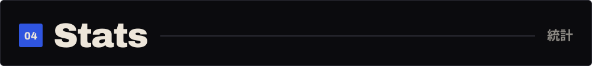
    </picture>

  
  

  

  

    <picture>
      <source media="(max-width: 600px)" srcset="./assets/m/interests.svg">
      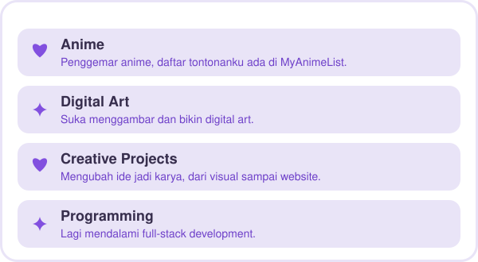
    </picture>

  <a href="https://instagram.com/this_whisky69">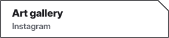</a>
  <a href="https://myanimelist.net/profile/Shakanaa">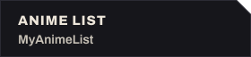</a>

    <picture>
      <source media="(max-width: 600px)" srcset="./assets/m/chat.svg">
      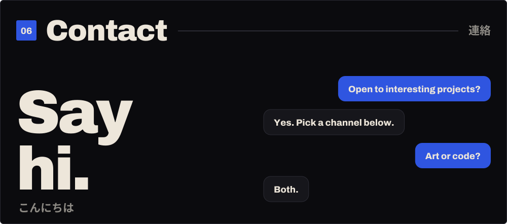
    </picture>

  <a href="https://discord.gg/vNMPTWY9s">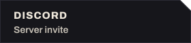</a>
  <a href="https://instagram.com/this_whisky69">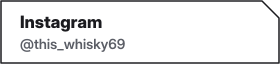</a>
  <a href="https://tiktok.com/@ryynx20">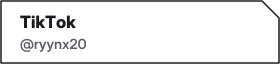</a>
  <a href="https://x.com/ThisRizky699">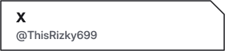</a>
  
  <a href="https://myanimelist.net/profile/Shakanaa">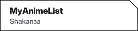</a>

    <picture>
      <source media="(max-width: 600px)" srcset="./assets/m/footer.svg">
      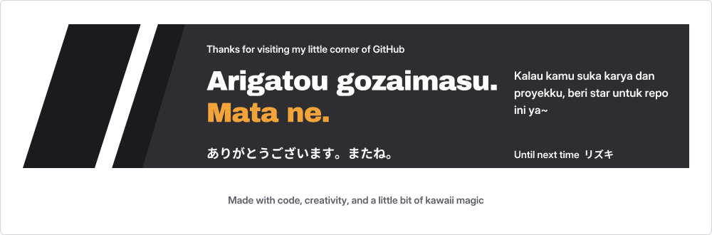
    </picture>

